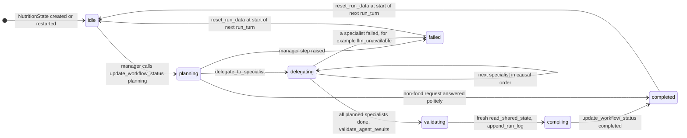
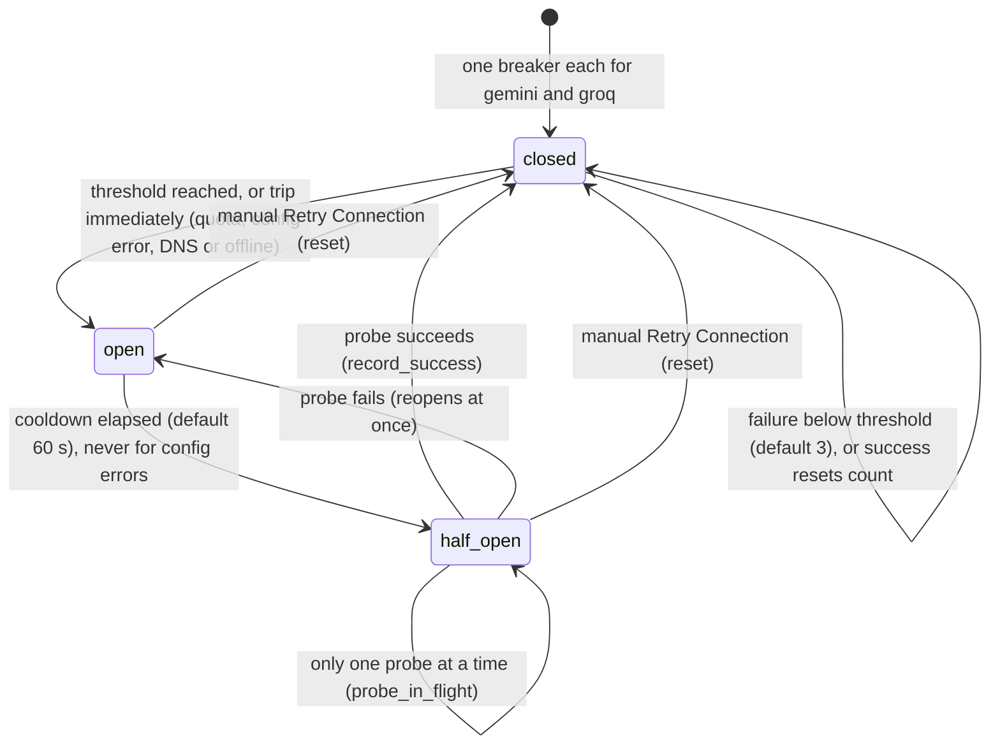
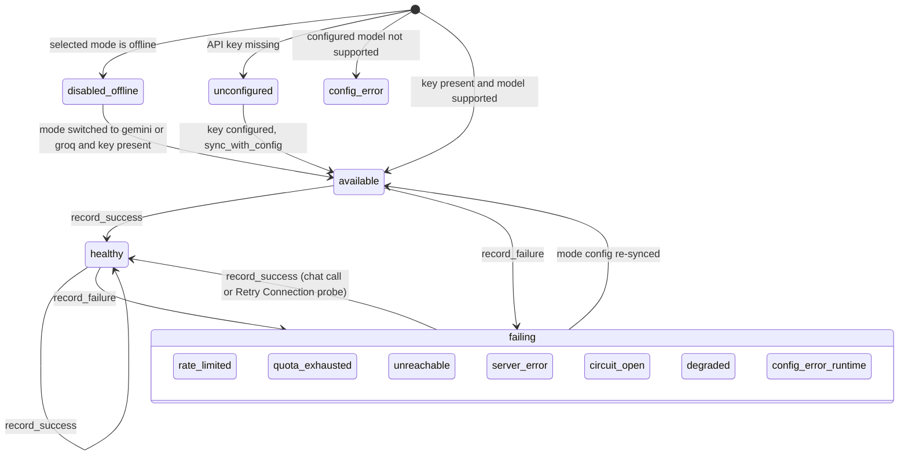
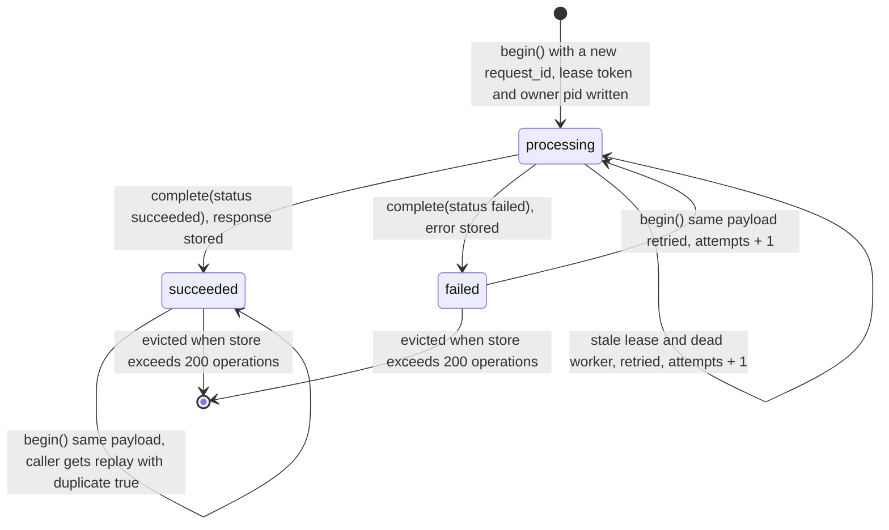
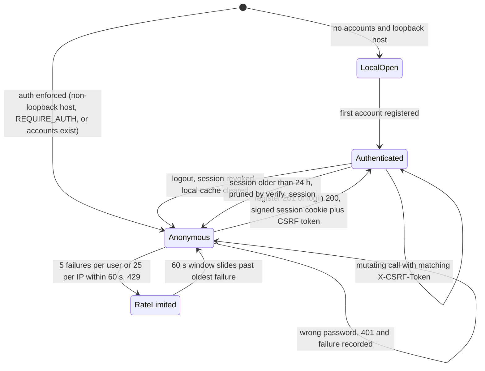
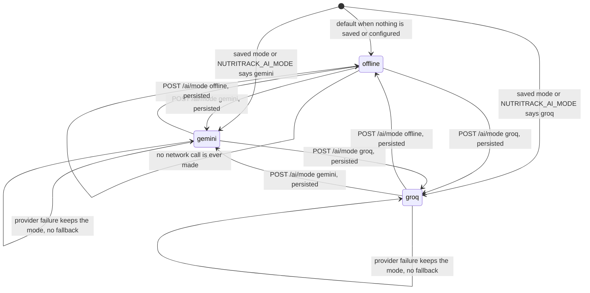
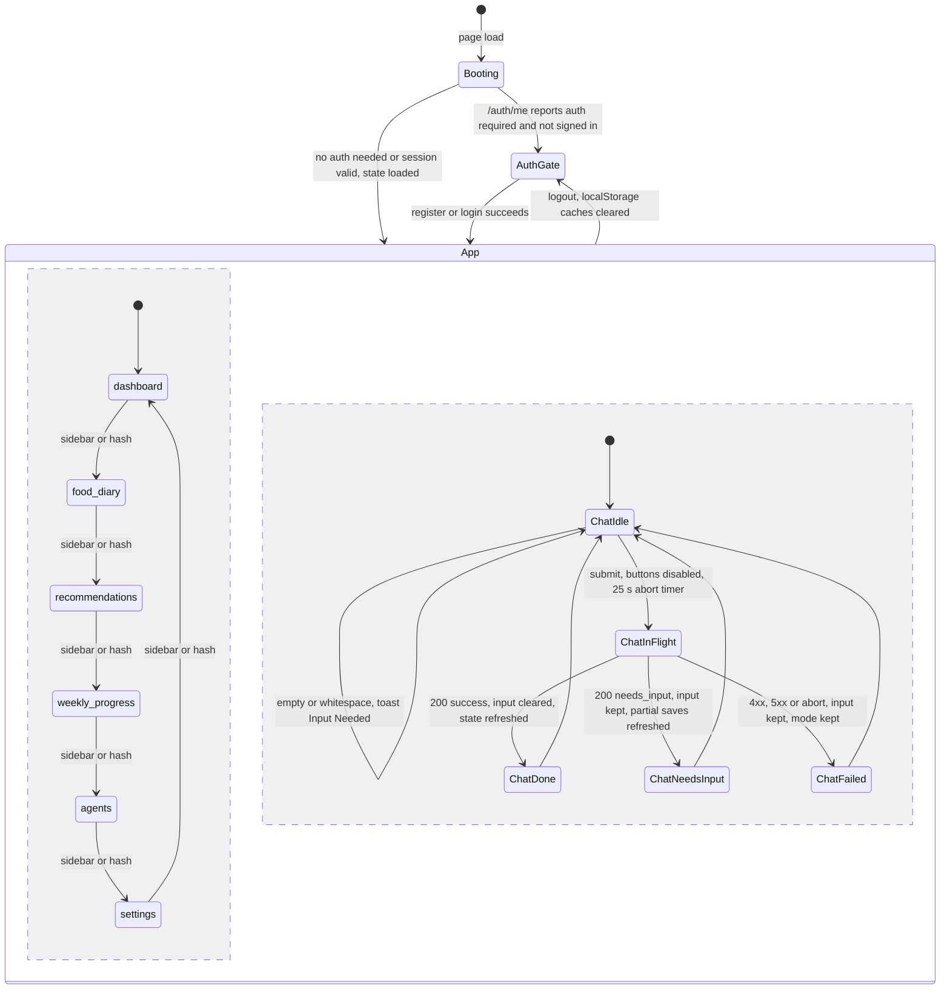

# NutriTrack — Reverse-Engineered Architecture, State Transition, ER, DFD, Flowchart & Information Retrieval Diagrams

All diagrams below were reverse-engineered from a full code walkthrough of the `nutritrack/` package and rendered into standalone vector `.svg` files in both [`docs/reverse_engineered/svg/`](file:///f:/7th%20sem/Agentic%20AI%20CSE%20476/NutriTrack/docs/reverse_engineered/svg) and [`docs/diagrams/`](file:///f:/7th%20sem/Agentic%20AI%20CSE%20476/NutriTrack/docs/diagrams), with raw `.mmd` sources in [`docs/reverse_engineered/mermaid/`](file:///f:/7th%20sem/Agentic%20AI%20CSE%20476/NutriTrack/docs/reverse_engineered/mermaid).

---

## 1. Information Retrieval (IR) System Found in Code

NutriTrack implements a **5-stage hybrid Information Retrieval (IR) & Candidate Ranking pipeline** spanning five modules:

1. **Temporal & Phrase Segmentation** ([`nutritrack/core/quantity.py`](file:///f:/7th%20sem/Agentic%20AI%20CSE%20476/NutriTrack/nutritrack/core/quantity.py)):
   - `extract_date_from_text()` parses ISO (`YYYY-MM-DD`), slash (`DD/MM/YYYY`), and relative (`today`, `yesterday`) dates and enforces a 400-day maximum backdate window.
   - `split_meal_text_with_meta()` extracts meal category (`breakfast`, `brunch`, `lunch`, `dinner`, `snack`) and splits multi-food utterances on `,`, `;`, `and`, `with`, `+`, `&`, and `plus` (preserving negative numbers while stripping `- ` list bullets).
   - `parse_item_text()` parses fractions (`1 1/2`), number words (`two`, `half`), attached units (`100g`), multiplier syntax (`2 x eggs`), unit aliases (`UNIT_ALIASES`), household units (`HOUSEHOLD_UNITS`), and plausibility bounds (`MAX_COUNT = 50`, `MAX_AMOUNT = 5000` g/ml).
2. **Per-User Scoped Lexical & Typo-Tolerant Fuzzy Matching** ([`nutritrack/ca1/food_database.py`](file:///f:/7th%20sem/Agentic%20AI%20CSE%20476/NutriTrack/nutritrack/ca1/food_database.py)):
   - `get_food_db(user_id)` merges `_BUILTIN_DB` with the user's isolated `data/custom_foods/<user_id>.json` cached by `(st_mtime_ns, st_size)`.
   - `match_details(query, user_id)`:
     - **Negative-phrase guard (`_NOT_SAME_AS`)**: Blocks composite/distinct foods (`paneer tikka`, `protein bar`, `almond milk`, `fried rice`, `egg roll`, etc.) from false-matching plain base foods (`paneer`, `milk`, `rice`, `egg`).
     - **Anti-hijack vocabulary guard (`exact_vocab`)**: Collects all exact tokens across all keys and aliases so a known word like `"chicken"` never fuzzy-remaps onto `"chickpeas"`.
     - **Token & fuzzy matching (`_matched_query_word`)**: Matches exact tokens first; for words of length $\ge 4$ sharing the same first character (`q[0] == alias_word[0]`) and not in `exact_vocab`, applies `difflib.SequenceMatcher(None, alias_word, q).ratio() >= 0.80`.
     - **Specificity ranking**: Ranks candidate aliases by `score = (len(alias_words), len(alias_string))`.
     - **Leftover-word confidence gate**: Computes `leftover_words = qwords - best_matched - FILLER_WORDS - digits`. Any non-empty leftover triggers `low_confidence_match` rather than guessing.
     - **Did-You-Mean suggestions (`did_you_mean`)**: Uses `difflib.get_close_matches(..., cutoff=0.60)` to return up to 3 suggestions without auto-applying them.
3. **Opt-In Two-Tier External Public Nutrition IR** ([`nutritrack/core/external_nutrition.py`](file:///f:/7th%20sem/Agentic%20AI%20CSE%20476/NutriTrack/nutritrack/core/external_nutrition.py)):
   - Active only when `NUTRITRACK_ONLINE_LOOKUP=1` and `selected_mode != "offline"` (enforced by `assert_network_allowed("external_nutrition")`).
   - Uses an in-memory LRU cache (`_CACHE`, max 500 entries), single-flight request deduplication (`_IN_FLIGHT` `threading.Event`), and a thread-local `4.0s` total deadline budget (`2.5s` per HTTP request).
   - **Tier 1 — USDA FoodData Central (`/fdc/v1/foods/search`)**: Queries `Foundation,SR Legacy`, requires every singularized non-stop query word to appear in the description (`_name_matches`), extracts nutrient codes (`208`/`957`/`958` kcal, `203` protein, `205` carbs, `204` fat, `291`/`1079` fiber), and parses household portion weights from `foodMeasures` / `/food/<fdcId>`.
   - **Tier 2 — Open Food Facts (`v2 Search API` + `CGI` fallback)**: Rejects derivative modifiers (`oil`, `spray`, `seasoning`, `syrup`, `supplement`), converts `energy-kj_100g / 4.184` when `energy-kcal_100g` is absent, and selects the product minimizing `len(cand_words - q_words - _STOP_WORDS)`.
   - Every external hit is tagged with `provenance` (`"usda_fdc"` or `"open_food_facts"`) and is **never silently persisted** to local custom foods.
4. **Unit Coercion & Linear Nutrient Scaling** ([`nutritrack/core/nutrition.py`](file:///f:/7th%20sem/Agentic%20AI%20CSE%20476/NutriTrack/nutritrack/core/nutrition.py)):
   - `_convert()` and `coerce_diary_portion()` convert household and metric units (`kg=1000g`, `l=1000ml`, `cup=240ml`, `bowl=200g`, `tbsp=15ml`, `tsp=5ml`, plus food-specific `portions{}`) into the entry's native unit (`g`, `ml`, `piece`, `slice`, `scoop`), then scale macros by `scale = effective_amount / base_amount`.
5. **Candidate Generation & Multi-Objective Recommendation Ranking** ([`nutritrack/tools/recommendation_tools.py`](file:///f:/7th%20sem/Agentic%20AI%20CSE%20476/NutriTrack/nutritrack/tools/recommendation_tools.py)):
   - Expands portion `LADDERS` across 12 meal `TEMPLATES` (`(protein, carb, veg)`, `(legume, carb)`, `(other)`, etc.) filtered by `diet_allows()` and `avoid`, then ranks candidates within `[max(80, 0.35 * min(rc, 600)), rc]` kcal using:
     $$\text{score} = 0.50 \cdot \text{protein\_score} + 0.25 \cdot \text{calorie\_fill} + 0.15 \cdot \text{variety} + 0.10 \cdot \text{preference}$$
   - Enforces diversity (`MAX_PER_MAIN_FOOD = 4`), reserves up to `MAX_OWN_FOODS = 5` user custom-food candidates, and re-verifies nutrition from scratch in `validate_recommendation_fit()`.

---

## 2. State Transition Diagrams (7 State Machines)

### 2.1 Agent Workflow Status (`nutritrack/state/nutrition_state.py`)
- **SVG**: [`state_01_workflow_status.svg`](file:///f:/7th%20sem/Agentic%20AI%20CSE%20476/NutriTrack/docs/reverse_engineered/svg/state_01_workflow_status.svg) | [`01_state_transition.svg`](file:///f:/7th%20sem/Agentic%20AI%20CSE%20476/NutriTrack/docs/diagrams/01_state_transition.svg)

### 2.2 Per-Provider Circuit Breaker (`nutritrack/ai/circuit_breaker.py`)
- **SVG**: [`state_02_circuit_breaker.svg`](file:///f:/7th%20sem/Agentic%20AI%20CSE%20476/NutriTrack/docs/reverse_engineered/svg/state_02_circuit_breaker.svg)

### 2.3 Provider Health Tracker (`nutritrack/ai/provider_health.py`)
- **SVG**: [`state_03_provider_health.svg`](file:///f:/7th%20sem/Agentic%20AI%20CSE%20476/NutriTrack/docs/reverse_engineered/svg/state_03_provider_health.svg)

### 2.4 Durable Operation / Idempotency Lifecycle (`nutritrack/state/operations.py`)
- **SVG**: [`state_04_operation_lifecycle.svg`](file:///f:/7th%20sem/Agentic%20AI%20CSE%20476/NutriTrack/docs/reverse_engineered/svg/state_04_operation_lifecycle.svg)

### 2.5 Authentication & Session Lifecycle (`nutritrack/web/auth.py`)
- **SVG**: [`state_05_auth_session.svg`](file:///f:/7th%20sem/Agentic%20AI%20CSE%20476/NutriTrack/docs/reverse_engineered/svg/state_05_auth_session.svg)

### 2.6 Authoritative 3-Mode AI Selection (`nutritrack/ai/config.py`)
- **SVG**: [`state_06_ai_mode.svg`](file:///f:/7th%20sem/Agentic%20AI%20CSE%20476/NutriTrack/docs/reverse_engineered/svg/state_06_ai_mode.svg)

### 2.7 Browser SPA Client State (`nutritrack/web/static/index.html`)
- **SVG**: [`state_07_ui_client.svg`](file:///f:/7th%20sem/Agentic%20AI%20CSE%20476/NutriTrack/docs/reverse_engineered/svg/state_07_ui_client.svg)

---

## 3. Entity-Relationship (ER) Diagram

- **SVG**: [`er_diagram.svg`](file:///f:/7th%20sem/Agentic%20AI%20CSE%20476/NutriTrack/docs/reverse_engineered/svg/er_diagram.svg) | [`02_er_diagram.svg`](file:///f:/7th%20sem/Agentic%20AI%20CSE%20476/NutriTrack/docs/diagrams/02_er_diagram.svg)
- **Mermaid Source**: [`er_diagram.mmd`](file:///f:/7th%20sem/Agentic%20AI%20CSE%20476/NutriTrack/docs/reverse_engineered/mermaid/er_diagram.mmd)

---

## 4. Data Flow Diagrams (DFD Level 0, Level 1 & Level 2 IR)

- **DFD Level 0 (Context)**: [`dfd_01_context.svg`](file:///f:/7th%20sem/Agentic%20AI%20CSE%20476/NutriTrack/docs/reverse_engineered/svg/dfd_01_context.svg) | [`dfd_01_context.mmd`](file:///f:/7th%20sem/Agentic%20AI%20CSE%20476/NutriTrack/docs/reverse_engineered/mermaid/dfd_01_context.mmd)
- **DFD Level 1 (Full System)**: [`dfd_02_level1.svg`](file:///f:/7th%20sem/Agentic%20AI%20CSE%20476/NutriTrack/docs/reverse_engineered/svg/dfd_02_level1.svg) | [`03_data_flow_diagram.svg`](file:///f:/7th%20sem/Agentic%20AI%20CSE%20476/NutriTrack/docs/diagrams/03_data_flow_diagram.svg) | [`dfd_02_level1.mmd`](file:///f:/7th%20sem/Agentic%20AI%20CSE%20476/NutriTrack/docs/reverse_engineered/mermaid/dfd_02_level1.mmd)
- **DFD Level 2 (IR & Recommendation Pipeline)**: [`dfd_03_level2_ir.svg`](file:///f:/7th%20sem/Agentic%20AI%20CSE%20476/NutriTrack/docs/reverse_engineered/svg/dfd_03_level2_ir.svg) | [`dfd_03_level2_ir.mmd`](file:///f:/7th%20sem/Agentic%20AI%20CSE%20476/NutriTrack/docs/reverse_engineered/mermaid/dfd_03_level2_ir.mmd)

---

## 5. System & IR Flowcharts

- **Flowchart 1 — End-to-End HTTP Request, Idempotency, Fast-Path & Multi-Agent Routing**: [`flowchart_01_request_routing.svg`](file:///f:/7th%20sem/Agentic%20AI%20CSE%20476/NutriTrack/docs/reverse_engineered/svg/flowchart_01_request_routing.svg) | [`04_flowchart.svg`](file:///f:/7th%20sem/Agentic%20AI%20CSE%20476/NutriTrack/docs/diagrams/04_flowchart.svg) | [`flowchart_01_request_routing.mmd`](file:///f:/7th%20sem/Agentic%20AI%20CSE%20476/NutriTrack/docs/reverse_engineered/mermaid/flowchart_01_request_routing.mmd)
- **Flowchart 2 — Information Retrieval (IR) & Food Resolution Algorithm**: [`flowchart_02_ir_pipeline.svg`](file:///f:/7th%20sem/Agentic%20AI%20CSE%20476/NutriTrack/docs/reverse_engineered/svg/flowchart_02_ir_pipeline.svg) | [`05_ir_pipeline.svg`](file:///f:/7th%20sem/Agentic%20AI%20CSE%20476/NutriTrack/docs/diagrams/05_ir_pipeline.svg) | [`flowchart_02_ir_pipeline.mmd`](file:///f:/7th%20sem/Agentic%20AI%20CSE%20476/NutriTrack/docs/reverse_engineered/mermaid/flowchart_02_ir_pipeline.mmd)
- **Flowchart 3 — 4-Step Meal Recommendation & Validation Pipeline**: [`flowchart_03_recommendation_pipeline.svg`](file:///f:/7th%20sem/Agentic%20AI%20CSE%20476/NutriTrack/docs/reverse_engineered/svg/flowchart_03_recommendation_pipeline.svg) | [`flowchart_03_recommendation_pipeline.mmd`](file:///f:/7th%20sem/Agentic%20AI%20CSE%20476/NutriTrack/docs/reverse_engineered/mermaid/flowchart_03_recommendation_pipeline.mmd)
